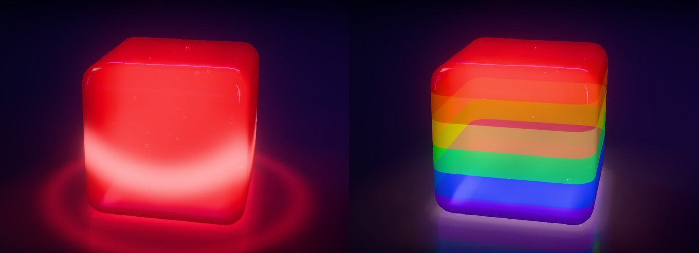

# Cube Simulator

A hyper-real, physically simulated jelly cube that runs in the browser.

**Play:** https://nickcason.github.io/cube-simulator/ — it installs as an app (Add to Home
Screen on iPhone, Install on Android and desktop Chrome/Edge) and then plays offline.

Grab it, throw it, poke it — then go to work on it:

| Tool | What it does |
| --- | --- |
| Hand | Drag to grab and throw, tap to poke |
| Knife | Swipe across the jelly to slice it (partial swipes leave a slit) |
| Nail gun | Fire nails that stay embedded and wobble with the jelly |
| Mallet | Smack it — frozen jelly shatters |
| Torch | Melt it until it sags, drips and caves in |
| Cryo spray | Freeze it solid and frosty |
| Melon baller | Scoop out a ball of jelly |
| Cherry bomb | Plant a bomb, stand back |
| Syringe | Pump it up until it bursts |
| Magnet | Pull the nails — and whatever they're stuck in |

**Heal** is a little choreography: nails slide out and clatter away, the
pieces lift and drift apart into an exploded view while each turns into its
final orientation, hover for a beat, then glide back together with glowing
seams and fuse — the seams flare white-hot and scorch the jelly round them
until a wave of light runs out and heals it clean — and settle gently onto
the table. Blasted-off drops fly back into the holes they came from, and
whatever was scooped or blown away rises back like glowing liquid from the
holes' walls as the seams weld.


**Make it yours** (the colour button in the dock):

- **Flavor** — cherry, lime, blue raspberry, grape, orange, lemon, watermelon, cola, any
  custom colour, or **Layers**: 2–10 stacked layers you colour yourself (tap a band in the
  little cross-section to pick its colour), starting from Rainbow, Pastel, Spectrum,
  Stripes, Sunset, Ocean, Aurora, Fire, Berry, Tropic, Neon, Candy or Duo. **Blend** runs
  from crisp seams to a smooth gradient, **Repeat** cycles the colours up to 6 times up
  the cube, and **Bias** crowds the bands toward the bottom or the top. The layers show on
  every cut face.
- **Material** — how it looks *and* how it behaves: Jello (clear, wobbly), Gummy (cloudy,
  chewy, firmer), Sour (sugar-crystal coating), Crystal (glass-clear), Creamy (milky
  panna-cotta), Slime (glowing, gooey, sticky), Water balloon (crystal-clear, heavy, all
  jiggle), Syrup (deep, slow, sticky), Mochi (soft, doughy, satin), Marshmallow (pale,
  powdery, light, squashes like foam), Rubber (dense, firm, bounces like a super ball)
  and Glass (clear, rigid, heavy, slippery).
- **Edges** — Sharp, Soft, Round or Pillow; the cube re-forms with the new rounding.
- **Glitter** — Off, Silver, Gold, Holo (rainbow, shifts with angle) or Rose flakes
  suspended in the jelly; they turn with every wobble, so it twinkles as it moves.
  Amount, Size and Sparkle live in Settings.

**Settings** (the sliders button) fine-tune everything live — each slider shows what it
means (Wobbly, Syrupy, Moon, Super ball…):

| Group | Settings |
| --- | --- |
| Feel | Firmness, Viscosity, Density (weight), Squash (volume keeping → foam), Bounce, Grip |
| Look | Opacity, Translucency, Colour depth, Gloss, Refraction |
| Bubbles | Count (0–240), Size |
| Glitter | Amount (sprinkle → galaxy), Size (dust → sequins), Sparkle |
| World | Gravity (Moon → Jupiter), Cube size |

Picking a material resets the material sliders (Feel and Look) to that material; **Reset**
puts everything back. Changing the edges of a whole cube morphs it into the new rounding (a
cut-up one re-forms with it).

Choices are remembered. You can also link straight to a combo, e.g.
`?flavor=rainbow&texture=gummy&edges=pillow`, or to your own layers (top → bottom):
`?layers=ffbe0b,ff6d00,f72585,7209b7,3a0ca3&blend=0.55`.


Keys: `1`–`0` tools, `H` heal, `M` sound, `L` glow mode, hold `Space` for slow motion, arrow keys tip the table, `S` shakes it. Drag empty space to orbit, scroll or pinch to zoom.

**Tilt & shake** (phones, Settings → World): tip the phone and the table tips with it — the
jelly leans, then slides once the pull beats its grip; shake the phone and the table jolts
under it.

**Glow mode** (the moon, top right, or `L`): lights out — the jelly shines in its own colour
over a glossy black floor that mirrors it and pools with its light, and every knock sends a
ring of light racing through it and out across the floor. Link to it with `?theme=dark`.



## How it works

- **Physics:** XPBD soft body on a tetrahedral mesh (~6.6k tets) with the stable
  Neo-Hookean constraints of Macklin & Müller (2021), rigid-motion-preserving
  damping, friction, inter-piece contact and sleeping. Self-contact keeps a
  watery cube from folding into itself and a flap still hinged on by a partial
  cut from dropping through its own body, and a regular look for folds catches
  anything that got pushed through anyway (in firm jelly too) and pops it back
  out. Temperature softens or stiffens the material per tet. Air bubbles ride
  along inside; one a cut runs through becomes a hollow in the cut face.
- **Cutting:** conforming tet splitting along implicit surfaces (planes, spheres)
  with vertex snapping for flat, clean cut faces; partial cuts are re-glued
  outside the knife stroke; frozen fracture splits along element boundaries.
- **Rendering:** three.js with a custom multi-pass jelly shader — per-pixel
  thickness from back-face depth, two-interface refraction with dispersion and
  total internal reflection, Beer–Lambert absorption, scattering, studio
  reflections (below the horizon, the real floor where the reflected ray lands)
  — drawn on the simulated surface subdivided twice where it curves (Phong
  tessellation, snapped at rest to the exact rounded-box shape). Caustics come
  from a grid of light rays bent through the jelly as the key light sees it
  (caustics mapping), coloured by the layers each ray crosses; the jelly is
  mirrored in the floor (drawn upside down into a blurred half-size target);
  then bloom, tone mapping, specular anti-aliasing, FXAA, and on phones a
  contrast-adaptive sharpen (FSR's EASU upscale is behind `?upscale`). Glow mode recaptures the studio's lighting
  as a dark room with neon strips and adds the jelly's own light: brighter
  through more of it, drifting slowly, pooling on the floor.
- **Sound:** every sound is synthesized with WebAudio.

## Develop

```sh
npm install
npm run dev     # http://localhost:5190
npm test        # physics/cutting tests (node --test)
npm run build
```
