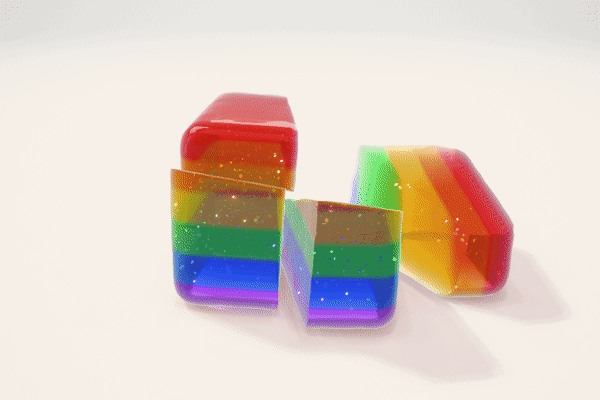
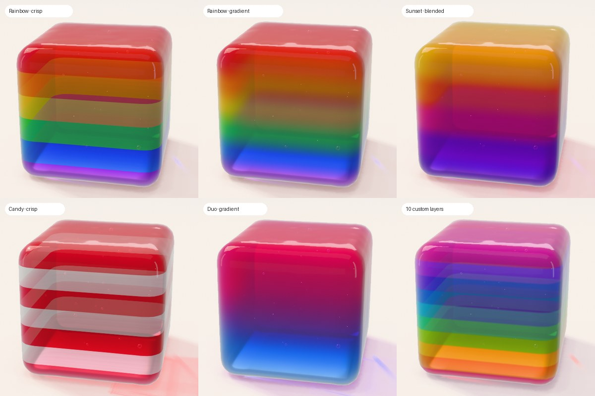

# Cube Simulator

A hyper-real, physically simulated jelly cube that runs in the browser.

**Play:** https://nickcason.github.io/cube-simulator/

Grab it, throw it, poke it — then go to work on it:

| Tool | What it does |
| --- | --- |
| Hand | Drag to grab and throw, tap to poke |
| Knife | Swipe across the jelly to slice it (partial swipes leave a slit) |
| Nail gun | Fire nails that stay embedded and wobble with the jelly |
| Mallet | Smack it — frozen jelly shatters |
| Torch | Melt it until it sags, drips and caves in |
| Cryo spray | Freeze it solid and frosty |
| Melon baller | Scoop out a ball of jelly |
| Cherry bomb | Plant a bomb, stand back |
| Syringe | Pump it up until it bursts |
| Magnet | Pull the nails — and whatever they're stuck in |

**Heal** is a little choreography: nails slide out and clatter away, the
pieces lift and drift apart into an exploded view while each turns into its
final orientation, hover for a beat, then glide back together with glowing
seams, fuse, and settle gently onto the table.



**Make it yours** (the colour button in the dock):

- **Flavor** — cherry, lime, blue raspberry, grape, orange, lemon, watermelon, cola, any
  custom colour, or **Layers**: 2–10 stacked layers you colour yourself (tap a band in the
  little cross-section to pick its colour), starting from Rainbow, Sunset, Ocean, Neon,
  Candy or Duo, with a **Blend** slider from crisp seams to a smooth gradient. The layers
  show on every cut face.
- **Texture** — Jello (clear, wobbly), Gummy (cloudy, chewy, firmer), Sour (sugar-crystal
  coating), Crystal (glass-clear), Creamy (milky panna-cotta).
- **Edges** — Sharp, Soft, Round or Pillow; the cube re-forms with the new rounding.
- **Glitter** — Off, Silver, Gold, Holo (rainbow, shifts with angle) or Rose flakes
  suspended in the jelly; they turn with every wobble, so it twinkles as it moves.
  Amount, Size and Sparkle live in Settings.

**Settings** (the sliders button) fine-tune everything live — each slider shows what it
means (Wobbly, Syrupy, Moon, Super ball…):

| Group | Settings |
| --- | --- |
| Feel | Firmness, Viscosity, Density (weight), Squash (volume keeping → foam), Bounce, Grip |
| Look | Opacity, Translucency, Colour depth, Gloss, Refraction |
| Bubbles | Count (0–240), Size |
| Glitter | Amount (sprinkle → galaxy), Size (dust → sequins), Sparkle |
| World | Gravity (Moon → Jupiter), Cube size |

Picking a texture resets the material sliders to that texture; **Reset** puts everything back.

Choices are remembered. You can also link straight to a combo, e.g.
`?flavor=rainbow&texture=gummy&edges=pillow`, or to your own layers (top → bottom):
`?layers=ffbe0b,ff6d00,f72585,7209b7,3a0ca3&blend=0.55`.




Keys: `1`–`0` tools, `H` heal, `M` sound, hold `Space` for slow motion. Drag empty space to orbit, scroll or pinch to zoom.

## How it works

- **Physics:** XPBD soft body on a tetrahedral mesh (~6.6k tets) with the stable
  Neo-Hookean constraints of Macklin & Müller (2021), rigid-motion-preserving
  damping, friction, inter-piece contact and sleeping. Temperature softens or
  stiffens the material per tet.
- **Cutting:** conforming tet splitting along implicit surfaces (planes, spheres)
  with vertex snapping for flat, clean cut faces; partial cuts are re-glued
  outside the knife stroke; frozen fracture splits along element boundaries.
- **Rendering:** three.js with a custom multi-pass jelly shader — per-pixel
  thickness from back-face depth, two-interface refraction with dispersion and
  total internal reflection, Beer–Lambert absorption, scattering, studio
  reflections — plus area-ratio caustics and a tinted shadow on the floor,
  bloom and tone mapping.
- **Sound:** every sound is synthesized with WebAudio.

## Develop

```sh
npm install
npm run dev     # http://localhost:5190
npm test        # physics/cutting tests (node --test)
npm run build
```
